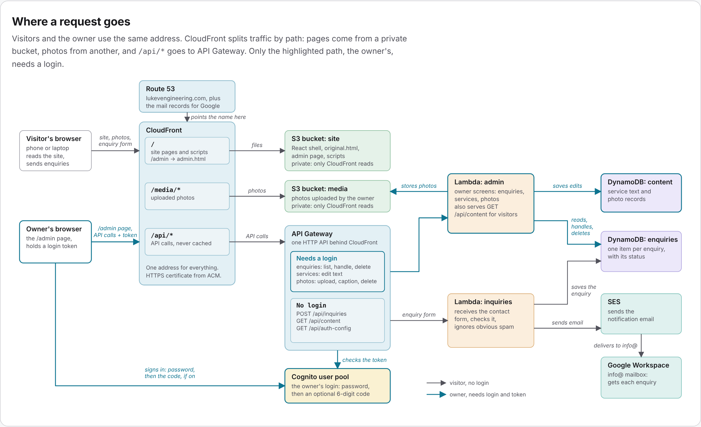
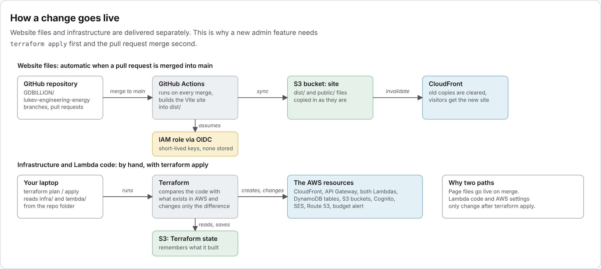

# LUKEV Engineering & Energy — React/TypeScript package

## Run locally
1. Install Node.js 20+.
2. In this folder run `npm install`.
3. Run `npm run dev` and open the local URL Vite prints.
4. Run `npm run build` for a production build.

## Migration note
The React/TypeScript entry point currently hosts the supplied original page in an iframe. This preserves the original HTML/CSS/JavaScript behavior—including its existing reveal animations, responsive menu, gallery/lightbox, WhatsApp links, and inquiry form behavior—without claiming these have been reimplemented as React components. This is a compatibility-first bridge, not a completed native React migration. The original page uses Tailwind's CDN and remote Unsplash images.

## Cinematic reveal timing update

The existing scroll reveal implementation has been refined without adding an animation library or changing the Intersection Observer trigger. The main reveal now runs for 1.45 seconds with a smooth ease-out curve; grouped direct children use a 1.25-second transition with a subtle stagger. The existing reduced-motion preference is also applied to the staggered children so content appears immediately when the visitor requests reduced motion.

### Updating an existing installation

If you already have this project installed, replace **`public/original.html`** with the `public/original.html` file from this ZIP. Keep the rest of your project and assets unchanged.

> **Warning:** the live `public/original.html` now contains two script lines and several ids that the backend and admin area depend on (see [What the page must keep](#what-the-page-must-keep)). If you replace the file wholesale, add them back, or the contact form and the editable services and photos stop working.

If you are installing this ZIP for the first time, extract it and run `npm install`, then `npm run dev` (or `npm run build` for a production build).

---

## Architecture

The website is a static site on AWS with a small serverless backend. A visitor and the owner use the same address, `https://lukevengineering.com`. CloudFront sends pages to a private S3 bucket, uploaded photos to a second private bucket, and `/api/*` to API Gateway.



| Part | What it does |
|---|---|
| Route 53, ACM | DNS for `lukevengineering.com` (and the mail records for Google Workspace) and the HTTPS certificate |
| CloudFront | The one public address. A small function maps `/admin` to `admin.html` |
| S3 `site` bucket | The built website (`dist/`) plus everything in `public/`. Private, read only by CloudFront |
| S3 `media` bucket | Photos uploaded by the owner, served at `/media/...`. Private, read only by CloudFront |
| API Gateway (HTTP API) | Public routes for visitors; routes that need the owner's login are checked against Cognito |
| Lambda `inquiries` | Receives the contact form, validates it, saves it to DynamoDB and emails `info@` through SES |
| Lambda `admin` | Owner screens: list, handle and delete enquiries; edit service text; upload and manage photos. Also serves the public `GET /api/content` |
| DynamoDB | `inquiries` table (one item per enquiry) and `content` table (service text and photo records) |
| Cognito | The owner's login. Accounts are created by hand; there is no public sign-up |
| SES + Google Workspace | Sends the notification email to the company mailbox `info@lukevengineering.com` |

### API routes

| Route | Login needed | Purpose |
|---|---|---|
| `POST /api/inquiries` | No | Contact form submission |
| `GET /api/content` | No | Edited service text and uploaded photos, used by `public/content.js` |
| `GET /api/auth-config` | No | Tells the admin page which Cognito app to sign in to |
| `GET /api/admin/inquiries` | Yes | List enquiries (filter with `?status=` set to `new`, `handled` or `all`) |
| `PATCH` / `DELETE /api/admin/inquiries/{id}` | Yes | Mark handled or reopen; delete |
| `GET /api/admin/content` | Yes | Same data as the public route, with save times |
| `PUT` / `DELETE /api/admin/services/{id}` | Yes | Save or reset the text of one service (`ndt`, `equipment`, `solar`) |
| `POST /api/admin/photos` | Yes | Upload one photo (the admin page resizes it to a JPEG first) |
| `PATCH` / `DELETE /api/admin/photos/{id}` | Yes | Change a caption, move to the front, delete |

The API must never answer with status 403 or 404. CloudFront turns those two codes into the site's home page (this is needed for the single-page shell), so the API uses 400 for every refusal.

## Deployment

Website files and infrastructure are delivered separately.



- **Website files** (`public/`, `src/`): merging a pull request into `main` runs GitHub Actions, which builds the site, copies it to the site bucket and clears CloudFront. AWS access uses short-lived credentials through OIDC; no AWS keys are stored in GitHub.
- **Infrastructure and Lambda code** (`infra/`, `lambda/`): changed by hand with Terraform from a laptop. Merging does **not** update these.

When a change touches both (a new admin feature, for example), run `terraform apply` first, then merge the pull request.

```
cd infra
terraform plan
terraform apply
```

Terraform keeps its state in a private S3 bucket (region `us-east-1`). Never commit `*.tfstate` or `*.tfvars` files.

## Repository layout (backend and admin)

| Path | Contents |
|---|---|
| `infra/` | Terraform: hosting, DNS, API, Lambdas, tables, Cognito, billing alert, GitHub OIDC role |
| `lambda/inquiries/` | Contact form Lambda and its tests |
| `lambda/admin/` | Admin and content Lambda and its tests |
| `public/inquiry.js` | Sends the contact form to `/api/inquiries` |
| `public/content.js` | Shows the owner's edited service text and photos on the page |
| `public/admin.html`, `admin.css`, `admin.js` | The owner's admin area at `/admin` |

Run the Lambda tests with `node --test lambda/inquiries/test.mjs` and `node --test lambda/admin/test.mjs` (Node 20 or newer).

## Admin area

`https://lukevengineering.com/admin` is for the owner only. After signing in he can:

- read enquiries, mark them handled and delete them;
- edit the text of the three services (NDT, Equipment Leasing, Solar Energy), with a button to restore the original wording;
- upload, caption, reorder and delete photos for the three galleries (up to 12 each; a gallery with none of his photos keeps the stock photos).

Changes appear on the website the next time a page is loaded, with no redeploy.

## What the page must keep

`public/content.js` and `public/inquiry.js` find things in `public/original.html` by id and structure. If the page is redesigned, keep these, or tell the backend maintainer before merging:

| Needed in `original.html` | Used by |
|---|---|
| `<script src="/inquiry.js" defer></script>` and `<script src="/content.js" defer></script>` near the end of `<body>` | Both scripts load only if these lines exist |
| A form with `id="inquiryForm"` and fields named `name`, `email`, `company`, `service`, `details` | Contact form submission |
| Three `<article>` cards inside `#services`, in the order NDT, Equipment, Solar, each with an `<h3>` and a `<p>` | Editable service name and short description |
| Sections `#ndt`, `#equipment`, `#solar`, each with an `<h2>`, an intro `<p class="leading-8">`, and the list: a `<ul>` in `#ndt` and `#solar`, a `.reveal > div.grid` of `<span>`s in `#equipment` | Editable headline, paragraph and list items |
| Containers `#ndtGallery`, `#equipmentGallery`, `#solarGallery` and the global function `openLightbox({ url, alt })` | Uploaded photos |

Everything the owner edits is inserted with `textContent` (never as HTML), so saved text cannot add markup or scripts to the page.

## Ownership

- Frontend: GDBILLION
- Infrastructure, backend, admin area and deployment: corneliusluuiz94
